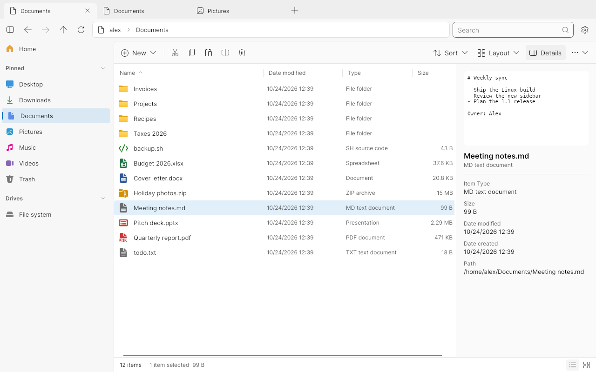
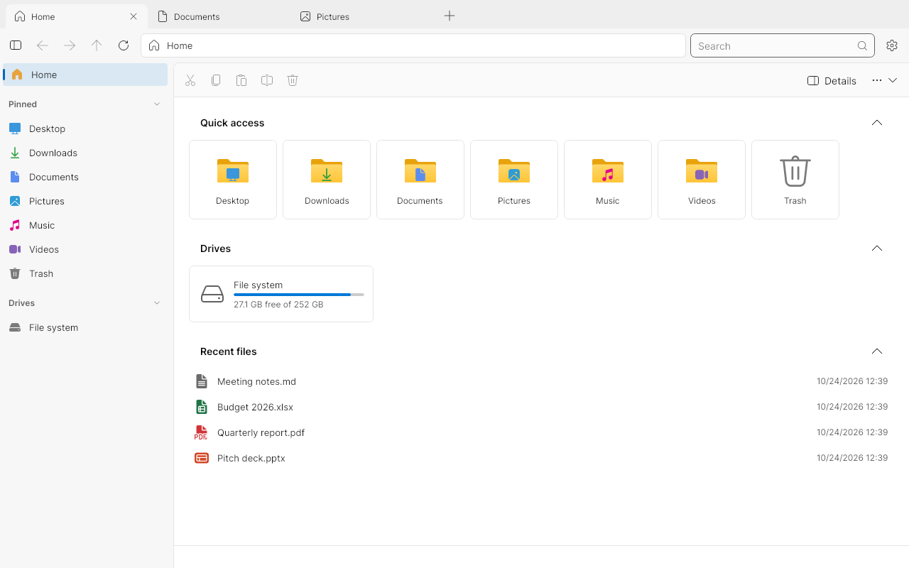
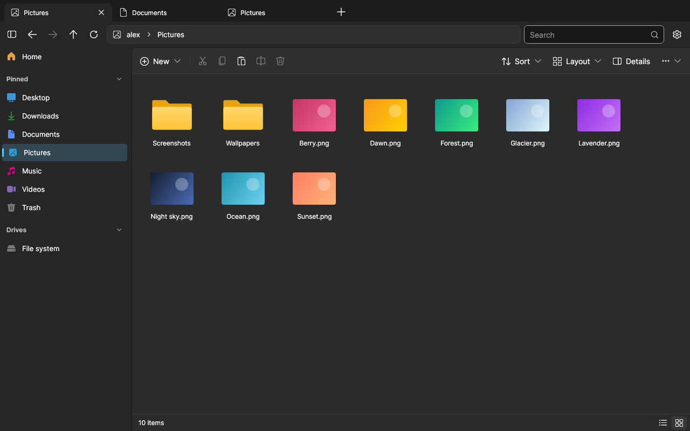

<p align="center">
  
</p>

<h1 align="center">Files</h1>

<p align="center">
  <b>A modern file manager for Windows — now on Linux too.</b><br />
  Tabs, a clean sidebar, a details pane and a design you'll actually enjoy using.
</p>

<p align="center">
  <a href="https://github.com/patchon-t/Fileslinux/actions/workflows/ci-linux.yml"></a>
  
  
  
  
</p>

<p align="center">
  <a href="#-install">Install</a> ·
  <a href="#-features">Features</a> ·
  <a href="#-screenshots">Screenshots</a> ·
  <a href="#-build-from-source">Build</a> ·
  <a href="#-contributing">Contributing</a>
</p>

<p align="center">
  
</p>

---

## ✨ Why Files?

Files is an open-source file manager built by the community. It brings the things people miss in the default file manager — **tabs**, **a details and preview pane**, **pinned folders**, **fast search** and **a modern Fluent design** — into one polished app we're getting this on linux for familiar experience.

This repository contains both versions:

| | Windows | Linux |
| --- | --- | --- |
| **App** | `src/Files.App` (WinUI 3) | `src/Files.App.Linux` (Avalonia) |
| **Runs on** | Windows 10 and 11 | Debian 12 and 13, Ubuntu and other Debian-based distros |
| **Package** | Microsoft Store / classic installer | `.deb` (amd64 and arm64) |
| **Languages** | 49 | Same 49 (shared translation files) |

## 📦 Install

### 🐧 Linux (Debian, Ubuntu)

1. Download `files-app_<version>_amd64.deb` (or `arm64` for ARM devices like a Raspberry Pi) from the latest run of the [**Files Linux CI** workflow](https://github.com/patchon-t/Fileslinux/actions/workflows/ci-linux.yml) (under **Artifacts**).
2. Install it:

   ```sh
   sudo apt install ./files-app_1.0.1_amd64.deb
   ```

   Keep the `./` — it tells apt to use the downloaded file.
3. Open **Files** from your app menu, or run `files` in a terminal (`files ~/Downloads` opens a folder).

Want Files to open whenever an app shows a folder? Make it your default file manager:

```sh
xdg-mime default files-app.desktop inode/directory
```

The package includes everything it needs — no .NET install required. Remove it any time with `sudo apt remove files-app`.

### 🪟 Windows

Get Files from the Microsoft Store, or use the classic installer. Buying Files on the Store helps support the project.

<p align="left">
  <a style="text-decoration:none" href="https://apps.microsoft.com/detail/9NGHP3DX8HDX?launch=true&mode=full">
    <picture>
      <source media="(prefers-color-scheme: light)" srcset="./assets/StoreBadge-dark.png" height="64" />
      </picture></a>
  &ensp;
  <a style="text-decoration:none" href="https://files.community/appinstallers/Files.stable.appinstaller">
    <picture>
      <source media="(prefers-color-scheme: light)" srcset="./assets/ClassicInstallerBadge-dark.png" height="64" />
      </picture></a>
</p>

## 🚀 Features

<table>
  <tr>
    <td width="50%" valign="top">
      <h4>🗂️ Tabs and navigation</h4>
      Open as many tabs as you like, reopen closed ones, and move around with back/forward history, a clickable path bar and keyboard shortcuts you already know.
    </td>
    <td width="50%" valign="top">
      <h4>📌 Sidebar</h4>
      Home, pinned folders, Trash and drives in one place. USB drives appear as soon as you plug them in, and you can eject them from the sidebar.
    </td>
  </tr>
  <tr>
    <td valign="top">
      <h4>🖼️ Layouts and previews</h4>
      Switch between Details, List and Grid views with image thumbnails. The details pane previews images and text files and shows file information.
    </td>
    <td valign="top">
      <h4>⚡ Everyday file work</h4>
      Copy, move, rename, delete, drag and drop, compress to ZIP and extract archives — with a progress center you can cancel from.
    </td>
  </tr>
  <tr>
    <td valign="top">
      <h4>🔎 Search</h4>
      Search the current folder and everything inside it, with <code>*</code> and <code>?</code> wildcards.
    </td>
    <td valign="top">
      <h4>🗑️ Real Trash</h4>
      On Linux, Files uses the same Trash as GNOME, KDE and XFCE, so you can restore anything you deleted — from any app.
    </td>
  </tr>
  <tr>
    <td valign="top">
      <h4>🎨 Light and dark</h4>
      Follows your system theme, or pick one yourself. The Fluent design matches across Windows and Linux.
    </td>
    <td valign="top">
      <h4>🌍 49 languages</h4>
      Translated by the community on Crowdin. The Linux version uses the very same translation files.
    </td>
  </tr>
</table>

The Windows app also has dual pane, Columns layout, file tags, Git integration, FTP and cloud drives. The Linux version doesn't have these yet — see [what's ported](../docs/linux.md#not-ported-yet).

## 📸 Screenshots

<table>
  <tr>
    <td width="50%"></td>
    <td width="50%"></td>
  </tr>
  <tr>
    <td align="center"><sub>Home: Quick access, drives and recent files</sub></td>
    <td align="center"><sub>Grid view with thumbnails, dark theme</sub></td>
  </tr>
</table>

<details>
  <summary>Files on Windows</summary>
  <br />
  
</details>

## ⌨️ Keyboard shortcuts

| Shortcut | Action | | Shortcut | Action |
| --- | --- | --- | --- | --- |
| <kbd>Ctrl</kbd>+<kbd>T</kbd> | New tab | | <kbd>F2</kbd> | Rename |
| <kbd>Ctrl</kbd>+<kbd>W</kbd> | Close tab | | <kbd>Delete</kbd> | Move to Trash |
| <kbd>Alt</kbd>+<kbd>←</kbd> / <kbd>→</kbd> | Back / forward | | <kbd>Ctrl</kbd>+<kbd>Shift</kbd>+<kbd>N</kbd> | New folder |
| <kbd>Ctrl</kbd>+<kbd>L</kbd> | Type a path | | <kbd>Ctrl</kbd>+<kbd>H</kbd> | Show hidden files |
| <kbd>Ctrl</kbd>+<kbd>F</kbd> | Search | | <kbd>Alt</kbd>+<kbd>Enter</kbd> | Properties |

See [all Linux shortcuts](../docs/linux.md#keyboard-shortcuts).

## 🛠️ Build from source

### Linux

You need the [.NET 10 SDK](https://learn.microsoft.com/dotnet/core/install/linux-debian).

```sh
dotnet run --project src/Files.App.Linux            # run the app
dotnet run --project tests/Files.App.Linux.Tests    # run the tests
packaging/linux/build-deb.sh amd64 1.0.0            # build a .deb into artifacts/linux/
```

More details, including the code layout, are in [docs/linux.md](../docs/linux.md).

### Windows

Follow the [building from source guide](https://files.community/docs/contributing/building-from-source) on the documentation site.

## 🤝 Contributing

Contributions are welcome, on both versions.

- **Found a bug or have an idea?** [Open an issue](https://github.com/files-community/Files/issues).
- **Want to send a fix?** Open an issue first so we can agree on the approach, then a pull request. Read the [contributing guidelines](./CONTRIBUTING.md) for the coding conventions.
- **Not sure where to start?** The [task board](https://github.com/orgs/files-community/projects/3/views/2) lets you sort tasks by size and priority.
- **Speak another language?** Help translate on [Crowdin](https://crowdin.com/project/files-app).

Chat with the community on [Discord](https://discord.gg/files).

## 📄 License

Files is released under the [MIT License](../LICENSE). Built and maintained by the [Files Community](https://files.community).
