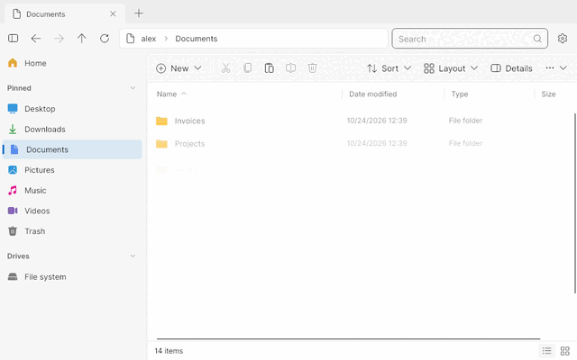
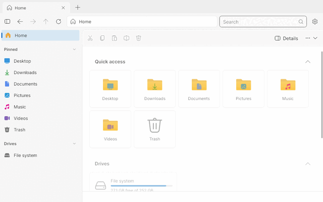
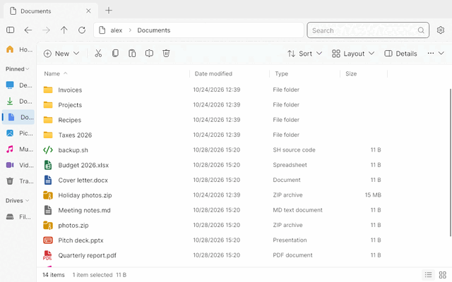
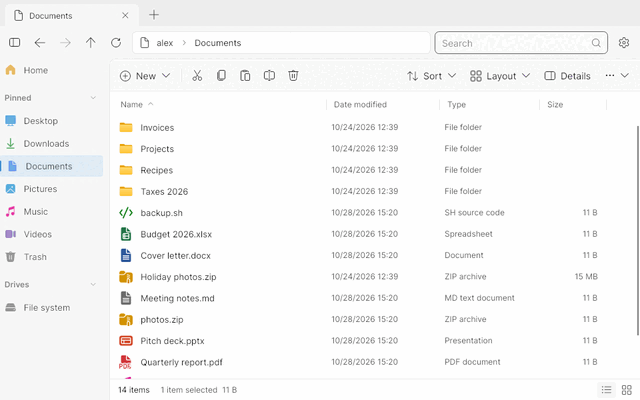
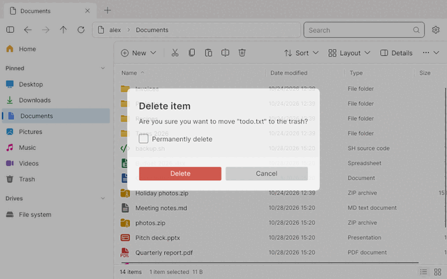
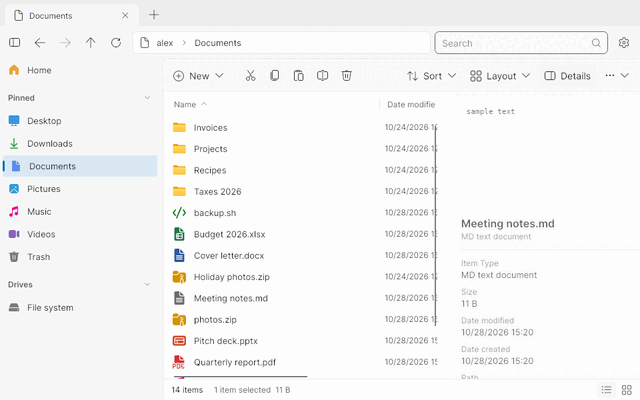

# Animations reference (Linux port)

The Linux port reproduces the motion of the Windows app. On Windows, Files gets its animations from WinUI 3 (Fluent Design): theme transitions, visual-state storyboards and the built-in control animations. Avalonia doesn't have those, so the Linux port rebuilds each one with the **same durations and easing curves**.

Use this page as the reference when you add or change motion in `src/Files.App.Linux`.

- Code: [`Helpers/Motion.cs`](../src/Files.App.Linux/Helpers/Motion.cs) (tokens and helpers) and [`Styles/Motion.axaml`](../src/Files.App.Linux/Styles/Motion.axaml) (style transitions and animations).
- Setting: **Settings → Appearance → Animations**. Turning it off removes `Styles/Motion.axaml` and makes every code-driven animation instant.
- Tests: [`AnimationTests.cs`](../tests/Files.App.Linux.Tests/AnimationTests.cs) checks that each animation runs and always ends fully visible and in place.

## Motion tokens

These match WinUI's theme resources. Always use them instead of new numbers.

| Token | Value | WinUI equivalent | Used for |
| --- | --- | --- | --- |
| `Motion.Faster` | 83 ms | `ControlFasterAnimationDuration` | Hover and press color changes |
| `Motion.Fast` | 167 ms | `ControlFastAnimationDuration` | Selection pill, tooltips, fades, dialog close |
| `Motion.Normal` | 250 ms | `ControlNormalAnimationDuration` | Menus, flyouts, dialog open, details pane, progress |
| `Motion.Entrance` | 300 ms | `EntranceThemeTransition` | Items and pages entering |
| `Motion.Pane` | 350 ms | Sidebar `KeyTime="0:0:0.35"` in `SidebarView.xaml` | Sidebar open and close |
| `Motion.Decelerate` | spline `0.1, 0.9, 0.2, 1.0` | Sidebar/entrance `KeySpline` | Things arriving or opening |
| `Motion.FastOutSlowIn` | spline `0, 0, 0, 1` | `ControlFastOutSlowInKeySpline` | Small state changes, fades |
| `Motion.Accelerate` | spline `1, 0, 1, 1` | Exit `KeySpline` | Things leaving or closing |
| `Motion.EntranceOffset` | 28 px | `EntranceThemeTransition` offset | Distance items rise when entering |
| `Motion.StaggerStep` | 14 ms | `IsStaggeringEnabled` | Delay between items in a list entrance |

The decelerate curve is front-loaded: most of the movement happens in the first ~100 ms, then it eases into place. That is what makes Windows animations feel quick even when they last 300–350 ms.

## Catalog

| Animation | Windows app (WinUI) | Linux port | Duration / curve | Preview |
| --- | --- | --- | --- | --- |
| **Folder contents enter** | ListView/GridView default `EntranceThemeTransition` with staggering; `ContentThemeTransition` in `DetailsLayoutPage.xaml` | `ShellView.PlayEntrance` → `Motion.StaggeredEntrance`: each visible row fades in and rises 28 px, 14 ms apart (first 24 rows). Plays on a new folder, search, layout change or tab switch, not on refresh | 300 ms, decelerate |  |
| **Home widgets enter** | `HomePage.xaml` widgets | `HomeView.PlayEntrance`: Quick access, Drives and Recent files rise in one after another | 300 ms, decelerate, staggered |  |
| **Sidebar open/close** | `SidebarView.xaml` pane storyboards (`TranslateX`, `KeyTime 0:0:0.35`, `KeySpline 0.1,0.9 0.2,1.0`) | `MainWindow.UpdateSidebarColumn`: the sidebar column width animates; when opening, the sidebar also slides in 24 px and fades in (250 ms) | 350 ms, decelerate |   |
| **Dialogs** | `ContentDialog` open/close (scale + fade, smoke layer fade) | `OverlayDialogService` → `Motion.DialogInAsync` / `DialogOutAsync`: card scales 1.05 → 1 and fades in over a fading dim layer; closing reverses it | Open 250 ms decelerate (smoke 167 ms); close 167 ms accelerate |  |
| **Details pane** | Info pane slide-in | `ShellView.OnMainPropertyChanged` → `Motion.SlideInAsync`: slides in 40 px from the right and fades in | 250 ms, decelerate |  |
| **Hover and press** | Every WinUI control's `BrushTransition` on PointerOver/Pressed | `Motion.axaml`: `BrushTransition` on the background and border of buttons, toggle buttons, drop-down buttons, list items, tabs and menu items | 83 ms | — |
| **Selection pill** | NavigationView/Sidebar selection indicator | `Motion.axaml`: the accent pill on the selected sidebar item stretches in (`ScaleY` 0 → 1) | 167 ms, fast-out-slow-in | — |
| **New tab** | `TabView` item added | `Motion.axaml`: new tab fades in and rises 8 px | 250 ms, decelerate | — |
| **Tab close button** | `TabViewItem` close button on hover | `Motion.axaml`: opacity transition | 83 ms | — |
| **Menus and flyouts** | `MenuFlyout` / `Flyout` open (slide + fade) | `Motion.axaml`: `MenuFlyoutPresenter`, `ContextMenu` and `FlyoutPresenter` fade in and slide down 12 px | 250 ms, decelerate | — |
| **Tooltips** | Tooltip fade | `Motion.axaml`: fade in | 167 ms, fast-out-slow-in | — |
| **Progress** | Status center progress bars | `Motion.axaml`: `DoubleTransition` on `ProgressBar.Value` so progress glides instead of jumping | 250 ms, fast-out-slow-in | — |
| **Thumbnails** | Thumbnails fade in when loaded | `ItemIcon`: the thumbnail fades in over the placeholder icon | 167 ms, fast-out-slow-in | — |
| **Settings pages** | Settings dialog page navigation (entrance) | `SettingsWindow`: the selected page rises 16 px and fades in | 300 ms, decelerate | — |

### Not reproduced

The Windows app suppresses page-navigation transitions between folders (`SuppressNavigationTransitionInfo`), so there is no slide between folders on either platform. These Windows animations are not in the Linux port yet: tab drag-reordering, `AnimatedIcon` icons (for example the animated chevrons and settings gear), the status center `RepositionThemeTransition`, and the Shelf pane.

## Adding a new animation

1. Find the matching animation in the Windows app (search `src/Files.App` and `src/Files.App.Controls` for `Storyboard`, `ThemeTransition` or `KeySpline`) and copy its duration and curve.
2. Use a token from the table above. For a hover/state change, add a `Transitions` setter in `Styles/Motion.axaml`. For something that plays once when a control appears, add a `Style.Animations` there. For anything triggered from code, add a helper to `Motion.cs`.
3. Animate only `Opacity`, `TranslateTransform.X/Y`, `ScaleTransform.ScaleX/Y` and brushes. Avalonia can't keyframe a `RenderTransform` written as a transform string (`translate(...)`); such an animation fails silently.
4. Make it respect the setting: styles in `Motion.axaml` already do; code must go through `Motion.*`, which checks `Motion.IsEnabled`.
5. Make sure the end state is "at rest" (opacity 1, no offset) and extend `AnimationTests` if the animation is new.
6. Add a row to the catalog above.

## Regenerating the previews

The GIFs are rendered from the real app, headlessly, frame by frame with their real timing:

```sh
docs/scripts/make-animation-gifs.sh
```

It needs the .NET 10 SDK and ImageMagick, and writes to `docs/images/animations/`.
